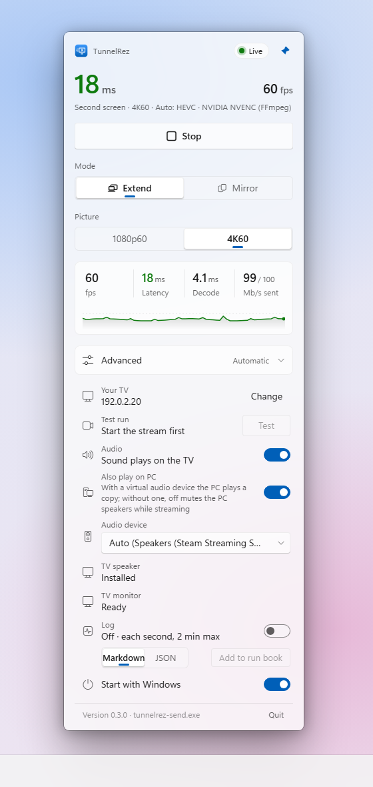

<div align="center">

# ⚡ TunnelRez

### Your PC. Your TV. One screen. Zero excuses.

**A PC → Android TV second monitor, written in Rust end to end and tuned until it squeaked.**

**[tunnelrez.com](https://tunnelrez.com)** · formerly SlipStream

[](#how-it-works)
[](#quick-start)
[](#quick-start)
[](#encoders)

[](docs/runbook/README.md)
[](docs/runbook/README.md)
[](#encoders)
[](#encoders)
[](#audio)
[](#the-app)
[](#the-app)
[](native/)
[](docs/runbook/README.md)
[](#quick-start)
[](docs/REMOTE-SPEC.md)



</div>

---

## Why this exists

We tried the tools built for this. They were thrown together for Windows, glued to whatever was lying around, and
never dialed in. Latency was "fine", 4K was "kind of", and nobody could tell you *why* a frame showed up late.

So we said **f\*\*k it** and rewrote the whole thing in Rust:

- **Our own capture → encode path.** Windows Graphics Capture / Desktop Duplication straight into the NVENC SDK.
  No ffmpeg in the hot path, no copies between GPUs, no guessing.
- **Our own TV app.** Native Rust on Android: no Java, no Kotlin, hardware decode straight onto the TV's 4K video
  plane with the MediaTek low-latency path switched on.
- **Our own wire protocol.** One tiny TCP stream for video, UDP for audio, every frame stamped with its capture time
  so the TV can tell you exactly where the milliseconds went.
- **Measured, not vibes.** Every real-TV run goes in the [run book](docs/runbook/README.md) with fps, decode time,
  glass-to-glass latency, frame gaps and GPU load. If a change doesn't beat the numbers, it doesn't ship.

## Is this for you?

> [!WARNING]
> **If your network is trash, this is not for you.** TunnelRez pushes 40–150 Mb/s at a fixed rate with no
> safety padding. Crowded 2.4 GHz, a mesh node in the attic, an ISP router on default settings: you'll see it, and
> no codec on Earth will save you.

> [!TIP]
> **If you keep a dialed-in network** (clean 5/6 GHz Wi-Fi with power save off, or better, a cable) **and the right
> settings on the PC, TunnelRez is built to outrun anything else out there.** Then stream your ass off. 🚀

| ✅ You'll love it | ❌ Skip it |
|---|---|
| Wired, or Wi-Fi 6/6E with a strong link | 2.4 GHz, mesh hops, a wall of neighbors |
| WMM Power Save **off**, QoS (WMM) **on** | "I've never logged into my router" |
| NVIDIA GPU (RTX 20 series or newer) | No GPU encoder at all |
| Android TV with hardware HEVC/AV1 decode | A cheap stick that drops frames at 1080p |

## Numbers

Real Android TV (MediaTek MT5895), RTX 5070 Ti laptop, home Wi-Fi, the moving test page full screen.
Every row links to its raw data in the [run book](docs/runbook/README.md).

| Mode | Codec | fps on the TV | TV decode | Capture → on screen |
|---|---|---|---|---|
| 1080p60 · 40 Mb/s | HEVC (native NVENC) | **59.9** | **5.5 ms** | **17.6 ms** |
| 1080p60 · 40 Mb/s | AV1 (native NVENC) | 59.9 | 7.0 ms | 22.6 ms · 0 drops |
| 4K60 · 100 Mb/s | HEVC (native NVENC) | **59.9** | **10.9 ms** | **36.3 ms** |
| 4K60 · 100 Mb/s | H.264 (native NVENC) | 59.9 | 14.7 ms | 43.3 ms · 0 drops |

That is the whole pipeline: capture, encode, Wi-Fi, decode and display.

## Features

- 🖥️ **True second monitor:** the TV shows up in Windows as a real extended display (or mirror). 1080p60 and 4K60.
- 🎯 **Native NVENC:** HEVC, AV1 and H.264, P1 ultra-low-latency, fixed rate with the bitrate you actually asked for.
- 🧠 **Auto that's actually smart:** probes every encoder on *your* PC, reads the TV's real decoder list, and greys
  out combos that can't keep up instead of letting you find out the hard way.
- 🔊 **Audio, in sync:** raw PCM over UDP in 5 ms packets, a clock-driven jitter buffer on the TV, a virtual
  "TV speaker" made the Windows default while you stream, and your old speakers put back after.
- 📊 **Live numbers:** fps, latency, decode time and Mb/s in the panel, every second.
- 📝 **Built-in logger + Test button:** one click puts the motion test page on the TV, logs 2 minutes, and adds the
  run to the run book.
- 🪶 **Tiny:** a Tauri tray app (vanilla HTML/CSS/JS, no Electron), a 1.4 MB sender, a native TV app.
- 🔁 **Fallbacks everywhere:** native NVENC → FFmpeg NVENC → Intel QSV → AMD AMF → Media Foundation → CPU.

## Quick start

**With the installer** (easiest): run `TunnelRez_<version>_x64-setup.exe`. It installs for you only (no admin) into
`%LOCALAPPDATA%\Programs\TunnelRez`, adds **TunnelRez** to the Start menu and an uninstaller to Apps, and replaces an
old SlipStream kit. Build it yourself with `.\tools\build-installer.ps1` (the file lands in `dist\`). The installer is
not code-signed yet, so Windows SmartScreen asks once ("More info" > "Run anyway").

> **Notice: Microsoft Defender can quarantine TunnelRez (a false positive).** While a stream starts, Defender may
> report `Behavior:Win32/DefenseEvasion.A!ml` and remove `tunnelrez.exe`, its Start menu and desktop shortcuts and
> its entry in Apps. TunnelRez is not malware; see [If Defender quarantines TunnelRez](#if-defender-quarantines-tunnelrez)
> for the cause and the fix.

The uninstaller unplugs the TV monitor, puts your sound devices back and removes the TV speaker only if TunnelRez
installed it. It removes the Parsec display driver only if you tick that box.

**From the kit** (a plain folder):

```powershell
.\tools\make-kit.ps1                 # builds dist\TunnelRez-kit.zip
# unzip it anywhere, then:
.\install.ps1                        # copies to %LOCALAPPDATA%\Programs\TunnelRez + Start menu
```

**From source:**

```powershell
# TV app
$env:TV_HOST = "<tv-ip>:5555"
cd receiver; .\build-and-install.ps1
# sender, virtual monitor helper, tray app
cd ..\sender; cargo build --release
cd ..\vdd;    cargo build --release
cd ..\app;    cargo build --release   # finds ..\sender\target\release\tunnelrez-send.exe by itself
```

Then open **TunnelRez** from the Start menu, pick **Extend** and **1080p60** or **4K60**, and hit Start. In
**Audio**, press **Install TV speaker** once.

<details>
<summary><b>Command-line streaming</b></summary>

```powershell
tunnelrez-send.exe --tv <tv-ip> --extend --size 1920x1080 --codec hevc
```

`--extend` reuses an existing virtual monitor and switches it to `--size` (60 Hz) if it shows another mode; it stops
with "could not switch the TV monitor to WxH@60" when Windows does not take the mode.

</details>

### Coming from SlipStream

- **PC:** the installer replaces the old kit. Your settings, logs and Start with Windows come along: the first start
  copies `%APPDATA%\SlipStream` and `%LOCALAPPDATA%\SlipStream` to `...\TunnelRez` (the old folders stay, delete
  them when you like). A TV speaker that SlipStream installed counts as TunnelRez's.
- **TV:** see [Switch the TV app](#switch-the-tv-app). Until you switch, the new PC app streams to the old TV app.

### Switch the TV app

The TV app has a new package name, `dev.tunnelrez.tv` (it was `dev.slipstream.tv`), so Android installs it as a
**new app** next to the old one. Both speak the same protocol; the PC streams to whichever is open.

1. Install the new one: `cd receiver; .\build-and-install.ps1` (with `$env:TV_HOST` set). It stops the old app
   first: while it runs, even in the background, it holds port 7878 and the new one cannot listen.
2. Open **TunnelRez** on the TV and stream once, to check it. If you opened the old app meanwhile, stop it
   (Settings > Apps > SlipStream > Force stop, or `adb -s $env:TV_HOST shell am force-stop dev.slipstream.tv`).
3. Remove the old one: on the TV, Settings > Apps > SlipStream > Uninstall, or
   `adb -s $env:TV_HOST uninstall dev.slipstream.tv`.

Its tuning (`debug.lrt.*` properties) and the `LRT` log tag are the same for both apps, so nothing to redo.

### If Defender quarantines TunnelRez

Microsoft Defender can report `Behavior:Win32/DefenseEvasion.A!ml` on `tunnelrez.exe` while a stream starts, and
quarantine the app, its shortcuts and its entry in Apps. This is a false positive. It is a machine-learning verdict
on what the app does, so Defender does not name the cause. These are the likely ones:

- For a steady 60 fps, the sender sets a 1 ms timer inside the FFmpeg process it starts (a thread that calls
  `timeBeginPeriod(1)`). Starting a thread in another process is also a malware technique.
- Windows picks the GPU per exe file. So the sender keeps renamed copies of itself and of FFmpeg in the install
  folder (`tunnelrez-probe-igpu.exe`, `tunnelrez-probe-dgpu.exe`, `ffmpeg-igpu.exe`, `ffmpeg-dgpu.exe`) and writes
  a GPU preference for each under `HKCU\Software\Microsoft\DirectX\UserGpuPreferences`.
- The files are not code-signed yet.

It is most likely when the capture restarts several times in a row, because each restart does the above again.

To get the app back:

1. Find the install folder. In a normal PowerShell window (**not** as administrator), run
   `"$env:LOCALAPPDATA\Programs\TunnelRez"` and copy the path it prints. Do this first: when the admin prompt is
   answered with another account, `$env:LOCALAPPDATA` is that account's folder, not yours.
2. Open PowerShell **as administrator**, add the exclusion for that folder, and list what Defender holds:

   ```powershell
   $dir = 'C:\Users\<you>\AppData\Local\Programs\TunnelRez'   # the path from step 1
   $mp  = "$env:ProgramFiles\Windows Defender\MpCmdRun.exe"
   Add-MpPreference -ExclusionPath $dir
   & $mp -Restore -ListAll
   ```

3. Restore only TunnelRez. A threat name alone does not prove that an item is this false positive, so restore by
   file path:

   ```powershell
   & $mp -Restore -FilePath "$dir\tunnelrez.exe"
   ```

   Then run the installer again: it puts back the shortcuts and the entry in Apps. Only when the list in step 2
   shows nothing but TunnelRez items under `Behavior:Win32/DefenseEvasion.A!ml`, this one command restores them
   all instead: `& $mp -Restore -Name 'Behavior:Win32/DefenseEvasion.A!ml' -All`. Leave every other item in
   quarantine.

With the exclusion, Defender no longer scans that folder: add it only when you trust your copy of TunnelRez (you
built it, or its SHA-256 matches the release's `SHA256SUMS`). For a kit or your own build, exclude that folder
instead. To take the exclusion away, as administrator: `Remove-MpPreference -ExclusionPath $dir` (the same full
path). The installer never changes Defender settings for you.

### Coming next: remote

Stream to a TV that is not on your network, through a relay you deploy yourself: see the
[TunnelRez Remote spec](docs/REMOTE-SPEC.md) (coming, not built yet).

## Dial it in

The difference between "works" and "holy sh\*t" is mostly your setup:

1. **Render the virtual monitor on the NVIDIA GPU** (hybrid laptops). See [Setup](#setup-render-the-virtual-monitor-on-the-nvidia-gpu-hybrid-laptops).
2. **Router:** WMM Power Save off, QoS (WMM) on, a clean 5 or 6 GHz channel, band steering off.
3. **PC Wi-Fi card:** Packet Coalescing off, MIMO Power Save "No SMPS", Roaming Aggressiveness lowest.
4. **TV:** Game picture mode, motion smoothing and noise reduction off.
5. **Bitrate:** 40 Mb/s at 1080p, 100 Mb/s at 4K. More is not better on Wi-Fi: a fixed rate pads every frame.
6. **Best of all: a cable.**

## How it works

```
 Windows PC                                              Android TV
┌──────────────────────────────────────┐   Wi-Fi/LAN   ┌──────────────────────────────┐
│ Parsec virtual monitor (on NVIDIA)    │               │ net thread (frame arrival)    │
│   └─ WGC / DDA capture  (D3D11)       │  TCP  video   │   └─ bounded queue            │
│        └─ BGRA → NV12 shader          │ ────────────▶ │        └─ MediaCodec (HW,     │
│             └─ NVENC (HEVC/AV1/H.264) │               │           MTK low-latency)    │
│                                       │  UDP  audio   │             └─ 4K video plane │
│ WASAPI loopback (TV speaker)          │ ────────────▶ │ AAudio + jitter buffer        │
│                                       │ ◀──────────── │ STATS · CAPS · PONG           │
└──────────────────────────────────────┘   stats/ctrl  └──────────────────────────────┘
```

| Part | Folder | What |
|---|---|---|
| Protocol | [`PROTOCOL.md`](PROTOCOL.md) | 24-byte header: HELLO / CONFIG / FRAME / PING / PONG / STATS / IDR_REQUEST / CAPS; audio as UDP datagrams |
| Sender | [`sender/`](sender/) | Windows. Capture → hardware or software encode → stream |
| Native path | [`native/`](native/) | D3D11 capture + NVENC SDK through hand-written FFI |
| Receiver | [`receiver/`](receiver/) | Android TV, native Rust (NativeActivity). Hardware decode straight to the video plane |
| Virtual monitor | [`vdd/`](vdd/) | Plugs one virtual monitor through the Parsec Virtual Display Driver |
| App | [`app/`](app/) | Tauri v2 tray panel |
| TV speaker | [`drivers/`](drivers/) | Bundled Steam Streaming Speakers driver (Microsoft-signed) |
| Run book | [`docs/runbook/`](docs/runbook/README.md) | Every real-TV run, with raw per-second data |

## The app

A Windows 11-style tray panel: Extend or Mirror, 1080p60 or 4K60, live fps/latency/decode/Mb/s, encoder and codec
pickers that only show what really runs on your PC and TV, a bitrate slider, the logger, the Test button and the TV
speaker install. It keeps your settings, starts with Windows if you want, and unplugs the TV monitor cleanly when
you stop.

## Roadmap

- [x] Native NVENC (HEVC / AV1 / H.264) · real fixed bitrate up to 150 Mb/s
- [x] True 4K60 on the TV · AV1 · decoder caps from the TV
- [x] Run book, logger, Test button
- [x] Audio with a virtual TV speaker
- [x] Windows installer (per user), the TunnelRez name
- [ ] TunnelRez Remote: any TV, anywhere, through your own relay ([spec](docs/REMOTE-SPEC.md), coming)
- [ ] Wi-Fi burst armor: small send buffer, frame skip, gap diagnostics
- [ ] The brain: logic-based bitrate control with operating zones + a TV diagnostics screen
- [ ] Our own Rust IddCx display driver (frame-exact timing, 1080p120, cursor sent apart from the picture)
- [ ] UDP video with fast in-frame resend
- [ ] Native Intel QSV and AMD AMF
- [ ] Color tuning

Details: [`docs/ROADMAP.md`](docs/ROADMAP.md). Changes per release: [`CHANGELOG.md`](CHANGELOG.md).

## Contributing

Read [`CONTRIBUTING.md`](CONTRIBUTING.md) and [`AGENTS.md`](AGENTS.md) (the layout, how to build and test every part,
the rules). Setting up a new PC and TV from zero: [`docs/AGENT-SETUP.md`](docs/AGENT-SETUP.md). Security issues:
[`SECURITY.md`](SECURITY.md). Pinned versions and why: [`docs/PINNED.md`](docs/PINNED.md).

---

## Reference

<details>
<summary><b>Encoders</b></summary>

<a id="encoders"></a>

One sender, one session code, two backends. `--encoder auto` (the default, and the app's "Auto") picks:

1. **native NVENC** (`native/`, `--backend native`): D3D11 capture (WGC or Desktop Duplication) straight into the
   NVENC SDK, H.264/HEVC/AV1. Used when the build has it (cargo feature `native`, on by default). It needs an NVIDIA
   GPU to encode, not to render the captured monitor: on another GPU's monitor the frames cross GPUs, which is slower.
   Only a failed real encode blocks picking it. `--encoder auto` uses it only when NVIDIA renders the monitor.
2. **ffmpeg** (`--backend ffmpeg`): ffmpeg `ddagrab` -> NVENC -> QuickSync -> AMF -> Media Foundation -> CPU
   (`libx264` / `libx265` / SVT-AV1), probed once, cached, demoted after 3 failures in a row. The native backend
   falls back to this the same way.

At start the sender logs the adapter (name + LUID) that renders the captured monitor, and warns when it is not
NVIDIA (slower, never blocked). `tunnelrez-send doctor` probes every ffmpeg backend and prints why each one works or not.
`tunnelrez-send caps --size WxH --fps 60` prints one JSON line: for each encoder (native, nvenc, qsv, amf, mf, cpu)
and codec, whether a short real encode keeps up at that size and why not (cached in
`%LOCALAPPDATA%\TunnelRez\encoders.json`, `--reprobe` tests again). The app greys out what cannot run, never starts
it, and `--encoder auto` skips backends `caps` measured as failing. Example: x265 (CPU HEVC) and SVT-AV1 manage only
~40-48 fps at 4K60 on a laptop CPU, so CPU + HEVC/AV1 is 1080p60 only there.

Bitrate: `--bitrate N` (the app's slider) is used as given for H.264, HEVC and AV1. For H.264 the sender sets the
level that carries the rate (4K60 up to 240 Mb/s is High 5.2, above that 6.x) and stops with a clear error past
level 6.2 (800 Mb/s); it never clamps. The start line shows what really ran:
`[encoder] bitrate requested 150.0 Mb/s, configured 150.0 Mb/s (fixed), H.264 level 5.2`.
The app's default, until the slider is moved, depends on the picture: 40 Mb/s at 1080p60, 100 Mb/s at 4K60
(`BITRATE_TABLE` in `app/src/settings.rs`). A fixed rate pads every frame, so on Wi-Fi a higher rate adds delay: at
1080p60, 150 Mb/s bounced into the yellow where 75 Mb/s was stable. The panel says so above 80 Mb/s at 1080p.

Windows' HEVC codec (HEVC Video Extensions) is needed only by the Media Foundation encoder (`hevc_mf`). NVENC
(native and ffmpeg) and the CPU encoder (x265) carry their own. When Media Foundation finds no HEVC encoder, the app
offers the Store pages (free "from Device Manufacturer" first, the paid one second).
Refresh is 60 Hz only (`--fps` is capped at 60; the virtual monitor always runs at 60 Hz).

</details>

<details>
<summary><b>Audio</b></summary>

<a id="audio"></a>

The PC's sound plays on the TV (`--audio on`, the default): WASAPI loopback, raw 48 kHz 16-bit stereo PCM in 5 ms
UDP datagrams (1.5 Mb/s), stamped with the same clock as the video. The TV plays it with AAudio through a small
jitter buffer (20-80 ms, adaptive) on a clock, never on its fill, and keeps it with the shown picture.

Virtual sink (as Sunshine and Apollo do it, `--audio-sink auto`, the default): when a virtual playback device is
installed (the "TV speaker": the Steam Streaming Speakers driver, bundled in `drivers/steam-streaming-speakers` and
installed with `tunnelrez-send audio-sink install` or the app's "Install TV speaker" button), the sender makes it
the Windows default for all roles while streaming, captures it, and puts the old defaults back after (a restore
record covers a killed sender; `tunnelrez-send audio-restore` runs it by hand). The PC speakers are then simply not
the default: `--audio tv-only` keeps the PC silent with no mute, and `--audio on` (the app's "Also play on PC") plays
a copy on the old speakers. `--audio-sink NAME` picks a device; `tunnelrez-send audio-devices` lists them. Without a
virtual device, loopback captures the PC speakers, and `--audio tv-only` mutes them while streaming and unmutes them
after (loopback still captures a muted endpoint; `tunnelrez-send audio-probe` checks a PC silently). `--audio off`:
video only. A TV app without audio support gets video only. Details: `PROTOCOL.md`, "Audio".

</details>

<details>
<summary><b>Requirements</b></summary>

- Windows sender: Rust stable. NVIDIA driver **610 or newer** for the native backend (NVENC API 13.1, Video Codec
  SDK 13.1); with an older driver it stops with a clear error and `--encoder auto` falls back to ffmpeg.
  ffmpeg 7+ on PATH for the ffmpeg backend (not needed for `--backend native`).
- Receiver: Rust + `armv7-linux-androideabi` target, Android NDK, cargo-ndk, JDK 17, Android SDK 34, **adb**.
- Virtual monitor: Parsec VDD 0.45 (`https://builds.parsec.app/vdd/parsec-vdd-0.45.0.0.exe`, signed by Parsec). The
  installer is bundled in [`drivers/parsec-vdd/`](drivers/parsec-vdd/); the app's TV monitor row installs it.
- Tray app (`app/`): Tauri v2, WebView2 (part of Windows 11).

Set the TV address once per shell: `$env:TV_HOST = "<tv-ip>:5555"` (PowerShell) or `export TV_HOST=<tv-ip>:5555`.

</details>

<details>
<summary><b>Setup: render the virtual monitor on the NVIDIA GPU (hybrid laptops)</b></summary>

<a id="setup-render-the-virtual-monitor-on-the-nvidia-gpu-hybrid-laptops"></a>

By default Windows renders the Parsec virtual monitor on the iGPU. Then the frames cross GPUs, which is slower. Tell
the Parsec driver to render on NVIDIA (admin PowerShell), then restart its adapter: disable and enable **Parsec
Virtual Display Adapter** in Device Manager (or reboot). The driver reads these values only when the adapter starts;
unplugging and plugging the virtual monitor does not apply them.

```powershell
$k = "HKLM:\SOFTWARE\Microsoft\Windows NT\CurrentVersion\WUDF\Services\ParsecVDA\Parameters"
New-Item -Path $k -Force | Out-Null
New-ItemProperty -Path $k -Name PreferredRenderAdapterVendorId -PropertyType DWord -Value 0x10DE -Force
```

The sender logs `[gpu] \\.\DISPLAYn is rendered by NVIDIA ...` at start. Do not read this from the `igpu:` line of
`--list-monitors` alone: in a laptop's dedicated-GPU mode the power-saving view lists NVIDIA's outputs under Intel too.
A monitor really on Intel is under Intel in both views.

The app's **Repair** button (below) sets these values for you and restarts the adapter. If they are right and the
monitor is still on the wrong GPU, the app says so during a stream, and Repair restarts the driver. Repair then checks
the real GPU (it plugs the TV monitor for a moment when none is there) and says if the monitor did not move. In that
case restart Windows and press Repair again; the TV keeps working until then, a little slower.

</details>

<details>
<summary><b>Repair the TV monitor</b></summary>

<a id="repair-the-tv-monitor"></a>

TunnelRez fixes what it can by itself when you press Start. A monitor that Windows leaves off the desktop is
attached, right of your other screens, and no other screen moves. A monitor that will not work is unplugged and
plugged again. You only see an error for what needs you.

In the panel, **Advanced > TV monitor** shows the driver's state. A failed start shows the same button:

| The app says | The button | What it does |
|---|---|---|
| Ready | none | nothing is wrong |
| Driver not installed | **Install** | runs the bundled, signed Parsec installer silently |
| Driver turned off, Driver has a problem, Set to the wrong graphics chip, A TV screen is stuck | **Repair** | does only what is needed: enables the adapter, restarts it, sets the render values, clears the stuck plug |
| Running on the wrong graphics chip | **Repair** | restarts the driver so it picks NVIDIA again, then checks that it did |
| A repair failed | **Reinstall driver** | runs the installer over the driver |
| The TV monitor still renders on another GPU | **Repair** | the same repair again, after you restart Windows; a reinstall would not help |
| Restart Windows to finish | none | restart Windows |

Each click shows one Windows prompt at most, and none when only a stuck plug is cleared. Declining the prompt changes
nothing. A running stream stops for the repair and starts again after it.

From a terminal:

```powershell
tunnelrez-send vdd status                  # one JSON line; reads only
tunnelrez-send vdd repair --dry-run        # what a repair would do; changes nothing
tunnelrez-send vdd repair                  # add --restart-adapter to restart a driver that looks fine
tunnelrez-send vdd install                 # add --force to run the installer over a working driver
```

`Generic Monitor (ParsecVDA)` entries in Device Manager under hidden devices are normal: Windows remembers earlier
monitors. `vdd status` counts them as `phantom`.

</details>

<div align="center">

**Built in Rust. Dialed in on a real TV. Now go stream your ass off.** ⚡

</div>
